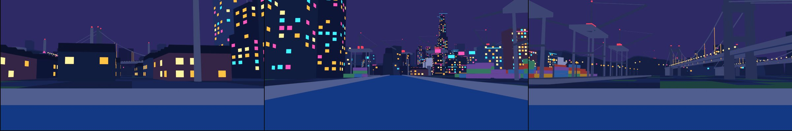
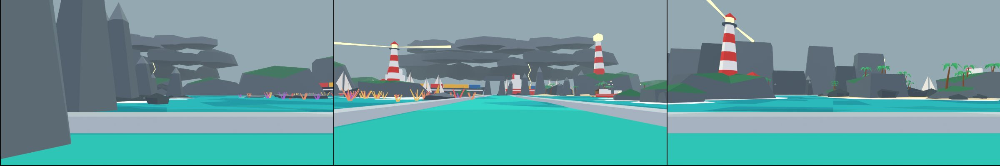
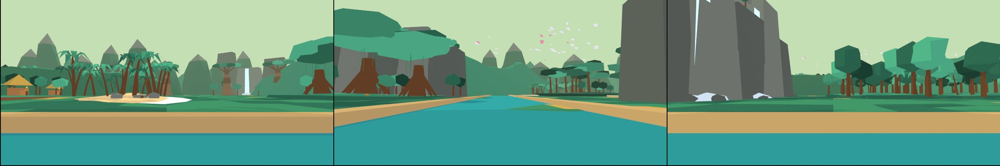
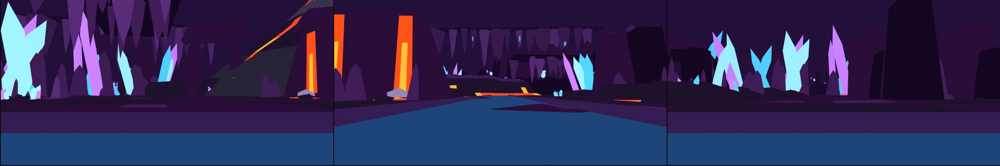
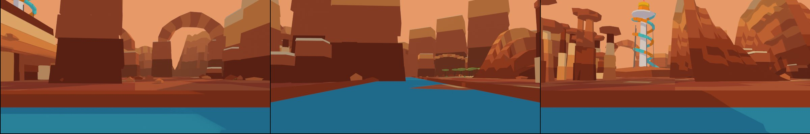
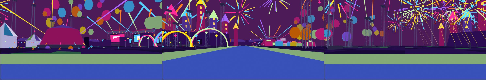

# Fondos de escenario por mundo (capas media, lejana y suelo de relleno)

Los niveles se ven vacíos más allá de las orillas. Cada mundo tiene tres capas hechas en Blender 4.5 con `gs_common.py` (materiales planos, FBX Y-up, frente = −Y de Blender = **forward (+Z) en Unity**). Nada se importa solo: se revisa y se copia a `Assets/_Project/`.

Cada pieza es **una sola malla** (varios materiales de color plano; los emisivos se llaman `E_<hex>`), con sombreado plano, sin colliders y con el **pivote en la base** (z = 0 = línea de agua / suelo). 1 unidad = 1 m.

## Cómo colocar cada capa

El eje del cauce es la ruta del nivel. Las distancias se miden desde esa línea; la **vista de prueba** (`<Mundo>/<Mundo>_Panorama.jpg`, de izquierda a frente a derecha, 84° cada una, con niebla) usa exactamente este reparto.

| Capa | Cuántas piezas | Distancia al cauce | Triángulos | Cómo se coloca |
|---|---|---|---|---|
| **Media** (`<Mundo>_Mid_*`) | 8 por mundo | pivote a **75-150 m** del eje (cada grupo mide ~100-190 m de ancho y 30-60 de fondo) | ≤ 5000 | A ambos lados del cauce, una cada **70-105 m** a lo largo de la ruta, alternando piezas al azar sin repetir hasta usar las 8. Giro: que su frente mire al cauce (`LookAt` al punto de la ruta) ±15°. Altura Y = línea de agua (0). |
| **Lejana** (`<Mundo>_Far_*`) | 6 por mundo | **250-560 m** del centro del nivel | ≤ 2000 | Anillo alrededor del nivel: 12-14 piezas con ángulos repartidos, radio alternado ~330 / ~500 m (±30), cada una mirando al centro (`LookAt`). Miden 150-670 m de ancho, así que se solapan un poco. Niebla activada. Altura Y = línea de agua (0). |
| **Suelo** (`<Mundo>_Ground_*`) | 4 por mundo | todo | ≤ 2000 | Y = **línea de agua − 0.4 m** (queda bajo el agua y bajo las orillas del nivel). `TileA`/`TileB`: cuadrícula de 200 m alternando A/B (5×5 alcanza ±500 m), centrada en el nivel. `Skirt`: una sola en el centro. `HorizonRing`: una sola en el centro, cierra el borde del mundo. |

Casos especiales:

- **Piezas elevadas** (llevan el contenido en el aire, sin tocar el suelo): `W2 Far_StormClouds` (z 55-155 m), `W3 Far_Birds`, `W6 Mid_Fireworks`, `W6 Far_Fireworks`, `W6 Far_Balloons`. Se colocan con Y = 0 como las demás.
- **Piezas colgantes** (pivote en el techo, la malla baja hacia −Y de Unity): `W4 Mid_Stalactites`, `W4 Far_Stalactites`, `W4 Ground_CeilingTile`. Colocarlas con Y = altura del techo de la cueva (la prueba usa 55 m para la media y 170 m para la lejana).
- **Pieza con luz propia** (`W5 Far_SunsetRidge`): lleva el disco del sol emisivo detrás de las crestas; girar la pieza para que el disco quede en la dirección de la que viene la luz direccional del nivel.

## Ajustes de importación en Unity

- Scale Factor 1, Mesh Compression Off, Read/Write Off, Generate Colliders **Off**, Generate Lightmap UVs Off, Normals Import.
- Static: *Batching Static* (las piezas lejanas también *Contribute GI* Off). Cast Shadows Off en la capa lejana; la media solo si hay presupuesto.
- Los materiales de color plano se reemplazan por el material toon URP del mundo; los `E_*` llevan emisión (neón, ventanas, cristales, lava, fuegos artificiales): en Unity ponerles `_EmissionColor` = color base × 2-3 y, si se quiere resplandor, Bloom en el Volume.
- **Niebla** (RenderSettings, lineal): inicio 40-70 m, fin 900-1200 m; el color de cada mundo está en la sección siguiente y coincide con el horizonte del cielo para que las siluetas lejanas se fundan.

## Mundos

### W1 · Fuga del Zoológico (ciudad de noche)

Ambiente de la prueba: Cielo `#070C26` → horizonte `#3B2C74`, niebla `#2E2A66`, luz de luna azulada.



**Capa media (≤ 5000 tris)**

| Archivo | Tris | Tamaño (X×Y×Z m) | Contenido |
|---|---|---|---|
| `W1_Mid_TowersA.fbx` | 1702 | 91×52×107 | 8 torres de oficinas con escalones, ventanas emisivas ámbar/cian/rosa y antenas con luz roja |
| `W1_Mid_TowersB.fbx` | 1920 | 113×61×161 | Supertorre de 150 m con borde de neón cian y 7 torres medias con neón rosa/cian |
| `W1_Mid_NeonBlock.fbx` | 1382 | 105×45×41 | Manzana baja con letreros de neón en las azoteas, franjas de neón y toldos |
| `W1_Mid_PortCranes.fbx` | 1420 | 133×102×54 | 3 grúas pórtico del puerto, muelle con farolas y pilas de contenedores de colores |
| `W1_Mid_BridgeLit.fbx` | 1866 | 240×14×41 | Puente colgante iluminado (240 m), péndolas ámbar y farolas |
| `W1_Mid_Warehouses.fbx` | 1022 | 116×104×29 | 9 bodegas con techo de dientes de sierra, tanques y chimeneas |
| `W1_Mid_Apartments.fbx` | 1090 | 117×22×45 | Bloques de apartamentos con balcones, ventanas cálidas y tanques de azotea |
| `W1_Mid_ZooPark.fbx` | 2481 | 118×70×44 | Parque del zoológico: noria de neón, arco de entrada, cúpula de cristal, árboles y farolas |

**Capa lejana (≤ 2000 tris)**

| Archivo | Tris | Tamaño (X×Y×Z m) | Contenido |
|---|---|---|---|
| `W1_Far_SkylineA.fbx` | 528 | 438×59×72 | Horizonte de rascacielos en dos filas (420 m), pocas ventanas emisivas |
| `W1_Far_SkylineB.fbx` | 644 | 425×59×128 | Horizonte denso y más alto, con agujas |
| `W1_Far_Harbor.fbx` | 1624 | 404×129×86 | Grúas, pilas de contenedores y dos buques del puerto |
| `W1_Far_Zoo.fbx` | 1404 | 376×45×88 | El zoológico al fondo: noria gigante, arco de entrada, cúpulas, carpas y arbolado |
| `W1_Far_Bridge.fbx` | 1062 | 648×20×114 | Gran puente colgante iluminado (650 m) |
| `W1_Far_Hills.fbx` | 1104 | 520×80×53 | Colinas oscuras con casas iluminadas |

**Suelo de relleno**

| Archivo | Tris | Contenido |
|---|---|---|
| `W1_Ground_TileA.fbx` | 800 | Losa de terreno 200×200 m (bordes planos, encaja con las vecinas) |
| `W1_Ground_TileB.fbx` | 800 | Losa de terreno 200×200 m, otro relieve (alternar con A) |
| `W1_Ground_Skirt.fbx` | 480 | Corona enorme de relleno (radio 280 → 3200 m) |
| `W1_Ground_HorizonRing.fbx` | 720 | Cadena de relieve de 360° a 1700-2400 m: cierra el horizonte |

### W2 · Mar Abierto (mar y tormenta)

Ambiente de la prueba: Cielo `#58676F` → horizonte `#A9BCC3` (cubierto), niebla `#93A8B0`, luz blanca difusa.



**Capa media (≤ 5000 tris)**

| Archivo | Tris | Tamaño (X×Y×Z m) | Contenido |
|---|---|---|---|
| `W2_Mid_Islet_A.fbx` | 1038 | 161×91×21 | Isla rocosa con musgo, playa y 7 palmeras más dos islotes |
| `W2_Mid_Islet_B.fbx` | 710 | 150×75×16 | Bancos de arena con palmeras, rocas y una cabaña |
| `W2_Mid_SeaStacks.fbx` | 677 | 222×75×48 | Nueve farallones con espuma en la base y un arco natural |
| `W2_Mid_FishingBoats.fbx` | 910 | 149×67×12 | Flota de 9 barcos pesqueros con boyas |
| `W2_Mid_LighthouseIsle.fbx` | 758 | 144×67×47 | Isla con faro rayado, casa, rocas y palmeras |
| `W2_Mid_Reef.fbx` | 2828 | 146×77×5 | Arrecife con rocas, corales de colores y espuma |
| `W2_Mid_Shipwreck.fbx` | 629 | 78×32×44 | Naufragio medio hundido con costillas, mástil, vela rota y restos |
| `W2_Mid_Sailboats.fbx` | 430 | 168×76×41 | 10 veleros y una goleta |

**Capa lejana (≤ 2000 tris)**

| Archivo | Tris | Tamaño (X×Y×Z m) | Contenido |
|---|---|---|---|
| `W2_Far_Islands.fbx` | 576 | 671×86×60 | Seis islas con espuma (670 m) |
| `W2_Far_StormClouds.fbx` | 744 | 588×112×154 | Bancos de nubes de tormenta (base a ~55 m de altura, se elevan hasta 150 m) y un rayo |
| `W2_Far_Lighthouse.fbx` | 316 | 144×65×98 | Faro lejano sobre un acantilado |
| `W2_Far_Ships.fbx` | 450 | 485×59×43 | Tres buques y tres veleros |
| `W2_Far_WaveWall.fbx` | 1024 | 460×120×22 | Olas grandes en el horizonte, crestas de espuma |
| `W2_Far_SeaCliffs.fbx` | 316 | 507×56×89 | Acantilados marinos con farallones |

**Suelo de relleno**

| Archivo | Tris | Contenido |
|---|---|---|
| `W2_Ground_TileA.fbx` | 800 | Losa de terreno 200×200 m (bordes planos, encaja con las vecinas) |
| `W2_Ground_TileB.fbx` | 800 | Losa de terreno 200×200 m, otro relieve (alternar con A) |
| `W2_Ground_Skirt.fbx` | 480 | Corona enorme de relleno (radio 280 → 3200 m) |
| `W2_Ground_HorizonRing.fbx` | 720 | Cadena de relieve de 360° a 1700-2400 m: cierra el horizonte |

### W3 · Selva de Madagascar (playa y selva)

Ambiente de la prueba: Cielo `#4C9FE0` → horizonte `#FFE7B0`, niebla `#C4DFB4`, sol cálido.



**Capa media (≤ 5000 tris)**

| Archivo | Tris | Tamaño (X×Y×Z m) | Contenido |
|---|---|---|---|
| `W3_Mid_CanopyA.fbx` | 1392 | 124×69×28 | Bosque de copas redondas y palmeras |
| `W3_Mid_CanopyB.fbx` | 1618 | 136×67×41 | Árboles emergentes en sombrilla con lianas |
| `W3_Mid_Baobabs.fbx` | 1654 | 121×58×51 | Cuatro baobabs sobre una loma de arena |
| `W3_Mid_PalmGrove.fbx` | 1506 | 136×60×20 | Playa con 24 palmeras, troncos y rocas |
| `W3_Mid_CliffFalls.fbx` | 853 | 122×40×66 | Acantilado con dos cascadas y bruma al pie |
| `W3_Mid_MossRocks.fbx` | 2496 | 110×56×13 | Peñascos con musgo, palmitas y lianas |
| `W3_Mid_Village.fbx` | 1114 | 120×59×18 | Aldea de cabañas con techo de paja, antorchas y árboles |
| `W3_Mid_FigTrees.fbx` | 1249 | 131×61×45 | Tres higueras estranguladoras con raíces aéreas y flores |

**Capa lejana (≤ 2000 tris)**

| Archivo | Tris | Tamaño (X×Y×Z m) | Contenido |
|---|---|---|---|
| `W3_Far_HillsA.fbx` | 1260 | 480×90×41 | Colinas de selva (capa cercana, verde oscuro) |
| `W3_Far_HillsB.fbx` | 960 | 480×90×69 | Colinas más altas y claras (capa lejana) |
| `W3_Far_Baobabs.fbx` | 1855 | 421×58×58 | Baobabs gigantes de 45-70 m |
| `W3_Far_Waterfalls.fbx` | 154 | 437×56×109 | Muro de acantilados con tres cascadas lejanas |
| `W3_Far_Birds.fbx` | 460 | 433×51×76 | Bandadas de aves (elevadas, z 58-134 m) |
| `W3_Far_Peaks.fbx` | 405 | 607×121×141 | Picos de selva con brumas |

**Suelo de relleno**

| Archivo | Tris | Contenido |
|---|---|---|
| `W3_Ground_TileA.fbx` | 800 | Losa de terreno 200×200 m (bordes planos, encaja con las vecinas) |
| `W3_Ground_TileB.fbx` | 800 | Losa de terreno 200×200 m, otro relieve (alternar con A) |
| `W3_Ground_Skirt.fbx` | 480 | Corona enorme de relleno (radio 280 → 3200 m) |
| `W3_Ground_HorizonRing.fbx` | 720 | Cadena de relieve de 360° a 1700-2400 m: cierra el horizonte |

### W4 · Cuevas y Volcán

Ambiente de la prueba: Cielo `#0D0616` → horizonte `#2C113C`, niebla `#22103A` (más cerca: inicio 40 m), luz cian tenue.



**Capa media (≤ 5000 tris)**

| Archivo | Tris | Tamaño (X×Y×Z m) | Contenido |
|---|---|---|---|
| `W4_Mid_CaveWall_A.fbx` | 1137 | 139×39×50 | Paredes de cueva con columnas de roca y cristales cian emisivos |
| `W4_Mid_CaveWall_B.fbx` | 1164 | 128×36×51 | Paredes con cristales magenta y vetas de lava emisivas |
| `W4_Mid_Stalactites.fbx` | 448 | 132×56×37 | 18 estalactitas. **Pivote en el techo** (la malla baja hacia z negativo) |
| `W4_Mid_Stalagmites.fbx` | 1174 | 114×54×31 | Bosque de estalagmitas con cristales |
| `W4_Mid_CrystalCavern.fbx` | 886 | 88×76×54 | Cúmulo gigante de cristales cian/magenta emisivos |
| `W4_Mid_LavaBank.fbx` | 1131 | 128×68×23 | Río de lava emisivo entre orillas de roca |
| `W4_Mid_LavaFalls.fbx` | 562 | 110×50×42 | Muro con tres cascadas de lava, charcos y vapor |
| `W4_Mid_RockPillars.fbx` | 736 | 123×36×43 | Pilares y arcos de roca con grietas incandescentes |

**Capa lejana (≤ 2000 tris)**

| Archivo | Tris | Tamaño (X×Y×Z m) | Contenido |
|---|---|---|---|
| `W4_Far_CaveWall.fbx` | 1368 | 480×61×107 | Pared de cueva de 480 m con cristales |
| `W4_Far_Stalactites.fbx` | 358 | 500×63×125 | Estalactitas gigantes (hasta 130 m). **Pivote en el techo** |
| `W4_Far_Volcano.fbx` | 666 | 592×543×429 | Volcán humeante de 230 m con ríos de lava emisivos, cráter incandescente y penacho de humo (la malla llega a 425 m con el humo) |
| `W4_Far_LavaField.fbx` | 1200 | 480×100×34 | Llanura de lava con grietas emisivas |
| `W4_Far_CrystalSpires.fbx` | 570 | 508×81×124 | Agujas de cristal gigantes sobre roca |
| `W4_Far_Arches.fbx` | 390 | 465×61×127 | Tres arcos de roca enormes |

**Suelo de relleno**

| Archivo | Tris | Contenido |
|---|---|---|
| `W4_Ground_TileA.fbx` | 800 | Losa de terreno 200×200 m (bordes planos, encaja con las vecinas) |
| `W4_Ground_TileB.fbx` | 800 | Losa de terreno 200×200 m, otro relieve (alternar con A) |
| `W4_Ground_Skirt.fbx` | 480 | Corona enorme de relleno (radio 280 → 3200 m) |
| `W4_Ground_HorizonRing.fbx` | 720 | Cadena de relieve de 360° a 1700-2400 m: cierra el horizonte |
| `W4_Ground_CeilingTile.fbx` | 800 | Techo de cueva de 200 m (pivote en el techo, relieve hacia abajo). Solo para niveles cerrados |

### W5 · El Gran Regreso (cañón al atardecer)

Ambiente de la prueba: Cielo `#5A4A8C` → horizonte `#FFB36B`, niebla `#E79A68`, sol bajo naranja.



**Capa media (≤ 5000 tris)**

| Archivo | Tris | Tamaño (X×Y×Z m) | Contenido |
|---|---|---|---|
| `W5_Mid_Mesas.fbx` | 1250 | 149×64×62 | Mesetas de estratos rojizos con rocas y arbustos |
| `W5_Mid_CanyonWall_A.fbx` | 1628 | 132×66×54 | Pared de cañón con terrazas y franjas de estratos |
| `W5_Mid_CanyonWall_B.fbx` | 1824 | 132×64×69 | Pared más alta con mesetas bajas delante |
| `W5_Mid_NaturalArch.fbx` | 452 | 122×46×59 | Arco natural de roca entre dos mesetas |
| `W5_Mid_Hoodoos.fbx` | 1664 | 97×59×41 | Chimeneas de hadas con sombrero |
| `W5_Mid_Terraces.fbx` | 1026 | 120×61×39 | Terrazas escalonadas con arbustos y peñascos |
| `W5_Mid_Flora.fbx` | 1400 | 126×53×14 | Acacias, cactus, arbustos y peñascos en arena |
| `W5_Mid_RockBridge.fbx` | 474 | 123×49×44 | Puente de roca entre dos mesetas |

**Capa lejana (≤ 2000 tris)**

| Archivo | Tris | Tamaño (X×Y×Z m) | Contenido |
|---|---|---|---|
| `W5_Far_WallsA.fbx` | 1440 | 480×80×104 | Paredes de cañón en capas (480 m) |
| `W5_Far_WallsB.fbx` | 1440 | 480×80×146 | Paredes más altas de seis estratos |
| `W5_Far_Mesas.fbx` | 360 | 415×63×143 | Seis mesetas grandes |
| `W5_Far_Arches.fbx` | 540 | 490×36×127 | Tres arcos naturales gigantes |
| `W5_Far_SlideTower.fbx` | 744 | 155×133×172 | La torre del megatobogán: torre, hélice de tobogán turquesa/naranja y cúpula dorada |
| `W5_Far_SunsetRidge.fbx` | 1102 | 480×94×121 | Tres crestas en capas con el disco solar emisivo detrás |

**Suelo de relleno**

| Archivo | Tris | Contenido |
|---|---|---|
| `W5_Ground_TileA.fbx` | 800 | Losa de terreno 200×200 m (bordes planos, encaja con las vecinas) |
| `W5_Ground_TileB.fbx` | 800 | Losa de terreno 200×200 m, otro relieve (alternar con A) |
| `W5_Ground_Skirt.fbx` | 480 | Corona enorme de relleno (radio 280 → 3200 m) |
| `W5_Ground_HorizonRing.fbx` | 720 | Cadena de relieve de 360° a 1700-2400 m: cierra el horizonte |

### W6 · Reino de Julien (fiesta nocturna)

Ambiente de la prueba: Cielo `#14072A` → horizonte `#8A1F78`, niebla `#4C1B58`, estrellas.



**Capa media (≤ 5000 tris)**

| Archivo | Tris | Tamaño (X×Y×Z m) | Contenido |
|---|---|---|---|
| `W6_Mid_Stage_A.fbx` | 1110 | 120×68×74 | Escenario de concierto con pantalla LED, cercha, altavoces, rayos y público |
| `W6_Mid_Stage_B.fbx` | 672 | 162×166×61 | Cúpula de DJ rayada con láseres y público |
| `W6_Mid_LightTowers.fbx` | 952 | 123×74×128 | Torres de luces de colores con focos y rayos |
| `W6_Mid_Balloons.fbx` | 1584 | 121×64×34 | 18 globos gigantes atados al suelo |
| `W6_Mid_Fireworks.fbx` | 1286 | 180×82×118 | Fuegos artificiales (mallas simples emisivas, elevadas a z 40-120 m) |
| `W6_Mid_Tents.fbx` | 1332 | 137×61×30 | Carpas de circo rayadas con guirnaldas de luces |
| `W6_Mid_Gifts.fbx` | 910 | 100×80×29 | Regalos gigantes con moño y un pastel de tres pisos |
| `W6_Mid_NeonArches.fbx` | 1340 | 132×27×19 | Arcos de neón y farolas de colores |

**Capa lejana (≤ 2000 tris)**

| Archivo | Tris | Tamaño (X×Y×Z m) | Contenido |
|---|---|---|---|
| `W6_Far_Stages.fbx` | 1204 | 574×152×158 | Cuatro escenarios con pantallas gigantes |
| `W6_Far_LightTowers.fbx` | 558 | 500×39×325 | Torres de luces de 80-130 m con rayos |
| `W6_Far_Fireworks.fbx` | 1384 | 497×160×201 | Cuatro fuegos artificiales grandes (elevados, z 76-277 m) |
| `W6_Far_Balloons.fbx` | 1632 | 480×70×163 | Campo de globos gigantes flotando (z 38-201 m) |
| `W6_Far_Palace.fbx` | 405 | 240×60×177 | Palacio de Julien con una corona gigante dorada |
| `W6_Far_PartyHills.fbx` | 1376 | 480×90×41 | Colinas con guirnaldas de luces |

**Suelo de relleno**

| Archivo | Tris | Contenido |
|---|---|---|
| `W6_Ground_TileA.fbx` | 800 | Losa de terreno 200×200 m (bordes planos, encaja con las vecinas) |
| `W6_Ground_TileB.fbx` | 800 | Losa de terreno 200×200 m, otro relieve (alternar con A) |
| `W6_Ground_Skirt.fbx` | 480 | Corona enorme de relleno (radio 280 → 3200 m) |
| `W6_Ground_HorizonRing.fbx` | 720 | Cadena de relieve de 360° a 1700-2400 m: cierra el horizonte |

## Regenerar

```
python Tools/Export/Backdrops/build_all.py            # los 6 mundos + panorámicas
python Tools/Export/Backdrops/build_all.py W3 --no-pano   # un mundo, sin panorámica
blender --background --python Tools/Export/Backdrops/backdrops_w4.py -- Far_Volcano   # una pieza
blender --background --python Tools/Export/Backdrops/render_panorama.py -- W5         # solo la vista de prueba
```

- `backdrop_lib.py`: constructor de mallas `B` (cajas, cilindros, lofts, blobs, cristales, rejillas de altura, coronas), suelo y anillo de horizonte genéricos, exportación y hoja de contacto (`Tools/Blender/previews/Backdrops_<Mundo>_sheet.png`, no se sube a Git).
- `backdrops_w1.py` … `backdrops_w6.py`: las piezas de cada mundo. Semilla fija por pieza: la generación es determinista.
- `render_panorama.py`: vista de prueba con sombreado toon de `gs_render.py` y niebla con el pase Mist.
